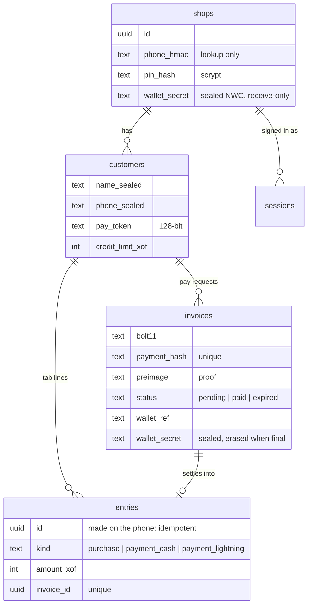
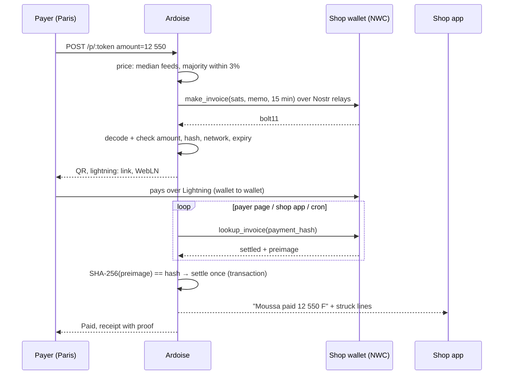

# Architecture

One SvelteKit 3 application (Svelte 5, TypeScript), server-rendered, progressively enhanced. The
same build runs in Docker (Node adapter) and on Vercel (serverless adapter).

```
src/
  hooks.server.ts         session → locals, locale, auth guard, security headers, request logs
  service-worker.ts       offline copy of the book; never caches pay links, receipts or APIs
  lib/
    money.ts ledger.ts    pure, shared by server and phone: FCFA formatting, FIFO settlement
    outbox.ts uuid.ts     offline queue with client-made ids
    reveal.ts             scroll animations that can never hide content
    i18n/                 fr (reference) + en, parity-tested
    components/           Sheet (<dialog>), Ledger, Qr (SVG), Icon, frames
    server/
      db/                 Postgres (pg) or embedded PGlite, SQL migrations under an advisory lock
      crypto.ts           AES-256-GCM sealing, HMAC lookups, scrypt PINs, tokens
      auth.ts session.ts  phone + PIN accounts, hashed sessions, lockout
      customers.ts entries.ts   tabs and ledger lines, always scoped by shop
      invoices.ts         create → verify → refresh → settle → reconcile
      rates.ts            BTC/EUR median of 4 exchanges, cache, demo-only fallback
      wallet/             NWC driver (Alby SDK), BOLT11 checks, SSRF guard, demo + faucet wallets
      ai/import.ts        Gemini reader for notebook photos
      demo.ts             per-visitor sandbox shops
  routes/
    /                     landing
    /signup /login /logout /bye /lang /demo
    /app                  the book (PIN-protected): /c/[id], /customers/new, /import, /wallet, /settings, /export
    /p/[token]            pay link → /p/[token]/i/[publicId] invoice
    /r/[publicId]         receipt with in-browser proof check
    /api/entries          offline outbox target (idempotent)
    /api/activity         live payment feed for the shop app
    /api/pay/.../invoices/[publicId]   payer polling
    /api/cron/reconcile   background settlement (Bearer CRON_SECRET)
    /api/health
```

## Data model



Money is stored in whole francs. Balances are derived from lines, never stored. Paid lines are
computed FIFO (payments strike the oldest purchases first), in `ledger.ts`, identically on the
server and on the phone.

## Payment lifecycle



## Choices worth explaining

- **NWC instead of running a node.** A corner shop will not run Lightning infrastructure. Nostr Wallet
  Connect lets it keep its own wallet (Alby Hub, or any NWC wallet) and give Ardoise a narrow,
  revocable, receive-only permission. No custody, no channel management, no hot keys on our server.
- **Verify, don't trust, the wallet.** Every invoice is decoded and checked before display; every
  settlement needs the preimage. The receipt lets the payer redo the check without trusting Ardoise.
- **Idempotency everywhere.** Ledger ids come from the phone; settlement is guarded by status and a
  unique index; at most one pending invoice per tab, amount and wallet. Retries are always safe.
- **Two databases, one SQL.** Postgres in production, PGlite (Postgres in WebAssembly) for local runs
  and tests, so tests exercise the real SQL, including concurrency.
- **Server-rendered, progressively enhanced.** The core path works as plain HTML forms: sign-up,
  sign-in, writing a purchase, paying a tab, reading a notebook page. JavaScript adds the sheets
  (cash payments, corrections, sharing), offline queueing and live updates.
- **Late payments are never lost.** An invoice is checked for 72 hours after it expires and is
  never marked expired without one last question to the wallet. Checks run from the payer's page,
  the shop's pages, a once-a-minute tick driven by any traffic (`background.ts`, kept alive with
  `waitUntil` on Vercel), and the cron.
- **FCFA first.** The shop thinks in francs; sats are an implementation detail shown to payers, and
  euros are shown because the diaspora thinks in them.
