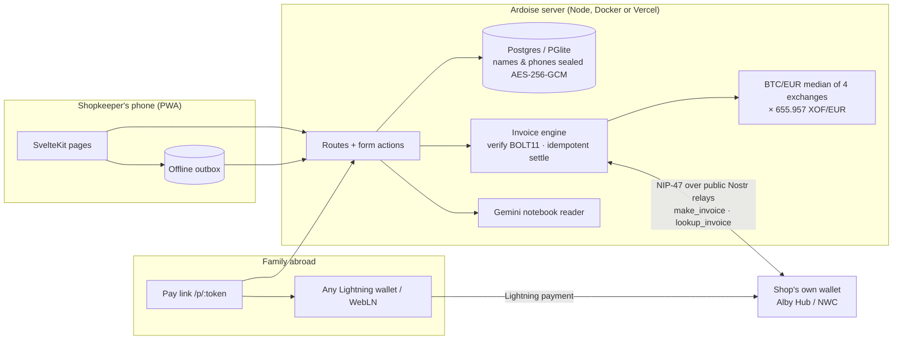

# Ardoise

**The corner shop's credit book, settled by family abroad over Bitcoin Lightning.**

In Dakar, as in most of West Africa, the neighbourhood _boutique_ sells on credit and writes it in a
school notebook: rice, oil, the morning bread, phone credit. The shopkeeper advances money they do
not have and waits for the end of the month. Meanwhile the family abroad sends money home through
agencies that charge some of the highest fees in the world, and that money does not always reach
the tab.

Ardoise turns the notebook into a phone app, gives every customer a link the shop can send on
WhatsApp, and lets a son in Paris or a sister in New York pay that tab directly with Lightning. The
payment lands in the **shopkeeper's own wallet**, the paid lines cross themselves out, and everyone
gets a receipt with a cryptographic proof of payment.

> Built for the **Dakar Bitcoin Hack 2026** (BTrust). Wallet integration: Lightning invoices through
> **Nostr Wallet Connect** (receive-only), payment from any Lightning wallet, **WebLN** for browser
> wallets.

---

## Try it

|                      |                                                                             |
| -------------------- | --------------------------------------------------------------------------- |
| One command          | `docker compose up --build` → <http://localhost:3000> → **Essayer la démo** |
| Without Docker       | `npm install && npm run dev` → <http://localhost:5173>                      |
| 3-minute demo script | [PITCH.md](PITCH.md)                                                        |

The demo creates a **private sandbox shop for each visitor** (Boutique Diallo, Médina) with seven
realistic tabs. In the default `faucet` mode its wallet is a real NWC wallet from
[faucet.nwc.dev](https://faucet.nwc.dev), reached over public Nostr relays: the invoice you see is a
real BOLT11 invoice from that wallet, and the "pay with the test wallet" button pays it with the
faucet's play-money sats. Everything after that (detection over NWC, preimage check, settlement,
receipt) is the production path. To demo with **real sats**, set `ARDOISE_DEMO_NWC_URL` to a
receive-only connection from your own Alby Hub.

## Who it is for

- **Primary user: the shopkeeper** (_boutiquier_), on a mid-range Android phone with patchy data.
  Daily workflow: dozens of credit purchases a day (two taps each, offline-safe), a WhatsApp reminder
  when a tab gets heavy, payments that show up as they land.
- **The payer: family abroad**, who opens a WhatsApp link, sees exactly what was bought, and pays in
  FCFA (with the euro equivalent shown) from any Lightning wallet. No account.
- **The customer at the counter**, whose tab is now visible, fair, and settled with a receipt.

**Why it matters (sources: World Bank).** Personal remittances are about **11 % of Senegal's GDP**
(2024). Sending $200 to Sub-Saharan Africa costs **8.46 %** on average (Q3 2025), the most expensive
region in the world, against a UN target of 3 % for 2030. Lightning network fees are typically well
under 1 %.

**Reach estimate (assumptions to validate in the pilot).** Senegal has around 18 million people and
a boutique in almost every street. If one shop serves ~100 households on credit and one household in
five has a relative abroad, each shop that adopts Ardoise opens a direct payment channel for ~20
diaspora families. A pilot of 50 shops in two Dakar neighbourhoods would reach ~1 000 families.

## What it does

**Shopkeeper (phone number + 6-digit code)**

- The book: who owes what, totals, tabs over their credit limit, search
- A tab: two-tap purchases with the shop's own frequent items (tap twice for ×2), cash payments,
  paid lines struck through in order (oldest first), mistakes crossed out, not deleted
- Send the tab: WhatsApp message with the balance and the link, any other app, copy, QR code for a
  relative visiting the shop, replace a link that went to the wrong person
- Live: "Moussa paid 12 550 F" appears on any screen the moment a payment lands
- Wallet: paste a Nostr Wallet Connect string; Ardoise tests it (1-sat invoice + lookup) and refuses
  any connection that can spend
- Import the paper notebook: photograph a page, **Gemini** transcribes it, the shopkeeper checks
  every line before it is saved
- Works offline: lines written without network wait on the phone and are sent when it returns
- French and English, CSV export, PIN change, sign out everywhere, delete the shop

**Payer (public link)**

- The tab's open lines, the amount due in FCFA and in euros, one-tap amount choices
- An invoice from the shop's own wallet as a QR code, a `lightning:` link, a copy button, and a
  one-tap **WebLN** button when a browser wallet (Alby…) is present
- A receipt with amount, rate, payment hash and preimage, and a **Verify** button that recomputes
  `SHA-256(preimage) = payment hash` in the browser

## Architecture



A payment, step by step:

1. The payer picks an amount. Ardoise prices it in sats from a live median (refusing to invoice if
   fewer than a majority of feeds agree within 3 %).
2. It asks the shop's wallet for an invoice over NWC, then **decodes it and checks** amount, payment
   hash, network and expiry before anyone sees it.
3. The payer pays from any wallet. The payment goes wallet to wallet; Ardoise never holds funds.
4. Ardoise asks the wallet (`lookup_invoice`), from the payer's page, the shop's pages and a
   background job. The tab is credited **only with a preimage that hashes to the payment hash**,
   exactly once, even when all three race.

More detail: [ARCHITECTURE.md](ARCHITECTURE.md) · Security: [THREAT_MODEL.md](THREAT_MODEL.md)

## Security by design (summary)

- **Least privilege:** NWC connections that can spend (`pay_invoice`, `pay_keysend`, `multi_pay_*`,
  `create_connection`) are refused; Ardoise only creates and looks up invoices.
- **Secrets:** wallet strings sealed with AES-256-GCM (per-record key context), customer names and
  phones sealed, the shopkeeper's phone stored as an HMAC, PINs hashed with scrypt + pepper,
  sessions stored as hashes, no API key in the repository or in URLs.
- **Validated input:** every form and endpoint goes through zod or explicit parsers; every invoice
  from a wallet is decoded and checked; relay hosts must resolve to public addresses (SSRF guard,
  re-checked on every connection).
- **Abuse limits:** PIN lockout counted before verification (holds under parallel guesses), rate
  limits on sign-up, sign-in, invoices, polling, imports and demo shops.
- **No PII in logs:** structured logs carry route ids, never URLs (pay links contain tokens); a
  scrubber masks phone numbers, invoices, hex secrets and API keys as a second line of defence.
- **Headers:** strict Content-Security-Policy (scripts only from the app), `frame-ancestors 'none'`, `nosniff`, `same-origin`
  referrer, `no-store` on private and payment pages, `noindex` on pay links and receipts.

## Constraints and how they are met

| Constraint       | Answer                                                                                                                                                            |
| ---------------- | ----------------------------------------------------------------------------------------------------------------------------------------------------------------- |
| Low bandwidth    | Payer page ≈ **84 KB** on first visit (HTML 7 KB, JS 49 KB, CSS 3 KB, fonts 24 KB), SVG QR codes, no images; photos shrunk to 1 600 px on the phone before upload |
| Mid-range phones | 48 px touch targets, Atkinson Hyperlegible for figures read in sunlight, no heavy framework UI                                                                    |
| Patchy network   | Offline outbox with idempotent entry ids, service worker for the book, payment detection that survives the payer closing the page                                 |
| Volatility       | Amount fixed in sats for 15 minutes; the shop decides when to convert                                                                                             |
| FCFA             | Fixed peg to the euro (655.957), formatted the way people write it (`12 500 F`)                                                                                   |
| Trust            | Receive-only wallet, preimage receipts anyone can verify, open source                                                                                             |

## Metrics

- **153 automated tests** (8 files): ledger maths, encryption at rest, shop isolation, idempotent
  entries, auth lockout (including 12 parallel guesses), sessions, SSRF address parsing, BOLT11
  encode/decode/verify, invoice settlement under concurrency, late payments, price agreement,
  open-redirect guard, notebook-import parsing.
- **Live Lightning test** (`npm run test:nwc`, also in CI): a faucet wallet over public relays issues
  an invoice, the shop switches wallets, the old invoice is paid, and the tab is still credited with
  a verified preimage.
- Checked by hand on the faucet demo: 1 500 F → 3 907 sats at 38.39 M F/BTC, settled in about 2 s.
- Gemini reads the sample notebook page (`static/samples/cahier.jpg`) completely: 10/10 lines,
  struck line and cash payment detected, margin dates carried down (~20 s).

## Run, test, configure

```sh
npm install
npm run dev            # http://localhost:5173, embedded Postgres in ./.data, demo enabled by .env
npm test               # unit and integration tests (in-memory Postgres)
npm run test:nwc       # live test against faucet.nwc.dev over public Nostr relays
npm run verify         # lint + types + tests + production build
```

Configuration lives in environment variables, all documented in [.env.example](.env.example):
`DATABASE_URL`, `ARDOISE_SECRET`, `ARDOISE_DEMO` (`off` | `simulated` | `faucet`),
`ARDOISE_DEMO_NWC_URL`, `GEMINI_API_KEY`, `ARDOISE_AI_MODEL`, `CRON_SECRET`.

Deploying on Vercel: set `DATABASE_URL` (e.g. Neon), `ARDOISE_SECRET` (32+ random characters),
`CRON_SECRET`; the build switches to the Vercel adapter automatically and `vercel.json` schedules
reconciliation.

## Next iteration

1. **Pilot with 10 shops** in Médina and Grand Yoff; measure tabs settled from abroad, days to
   repayment, and the share of credit paid over Lightning.
2. **Wolof** interface and voice notes for shopkeepers who do not read French comfortably.
3. **One-tap wallet setup** (NWC deep link with Alby Hub) instead of pasting a connection string.
4. **Payout to mobile money** (Wave / Orange Money) through a partner, for shops that want francs.
5. **Bitcoin Connect** modal on the pay page for payers with browser and mobile wallets.
6. **Reminders**: a weekly WhatsApp summary of tabs over their limit, sent by the shopkeeper.

## Licence

MIT, see [LICENSE](LICENSE). Fonts: Atkinson Hyperlegible Next (SIL Open Font License).
